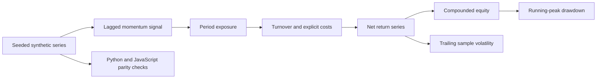

# Research Architecture

`backtest.py` defines data generation, configuration validation and the reference computation. `demo-run.json` carries an inspectable generated fixture. `research-ui.js` independently implements the same period convention and renders the diagnostics. The UI reads only the local fixture and computes changes in the browser.

Exposure for period t uses prices through t−1. Costs depend on absolute exposure changes. Equity compounds net returns, drawdown uses the running equity peak, and volatility uses a sample standard deviation with a stated 252-period annualisation assumption.

The model is deliberately focused. It is not an execution engine, portfolio-account system or calibrated empirical trading strategy. Private provider integrations, account records and original application modules are not part of this repository.
