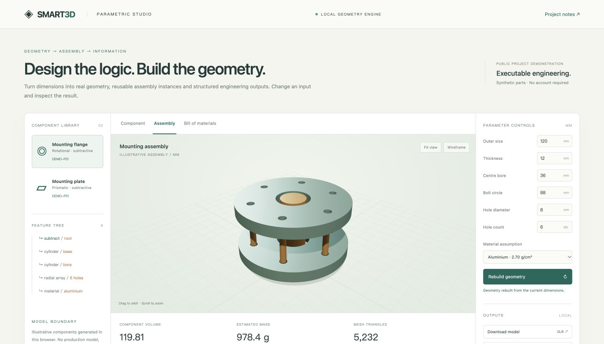

# Systems Research Lab

### Engineering systems, open to inspection.

A curated portfolio of executable projects spanning **parametric design, quantitative research, situational awareness, evidence-driven workflows and numerical engineering**. Each project connects explicit inputs with inspectable computation, interactive behaviour and a stated validation scope.

**[Open the portfolio](https://007jackiegao-cmd.github.io/systems-research-lab/)** · [Reviewer guide](PORTFOLIO_GUIDE.md) · [Project catalogue](PROJECTS.md) · [Validation matrix](VALIDATION.md)

## Selected projects

| Project | Engineering focus | Explore |
|---|---|---|
| **SMART3D** | Parametric solids, assembly instances, BOM and GLB export | [Workbench](https://007jackiegao-cmd.github.io/smart3d-showcase/) · [Repository](https://github.com/007jackiegao-cmd/smart3d-showcase) |
| **Quant Signal Lab** | Time-aligned signals, explicit costs, equity and risk diagnostics | [Workbench](https://007jackiegao-cmd.github.io/quant-signal-lab/) · [Repository](https://github.com/007jackiegao-cmd/quant-signal-lab) |
| **Scenario Intelligence Lab** | Geospatial context, scenario attribution and opposing-effect detection | [Workbench](https://007jackiegao-cmd.github.io/scenario-intelligence-lab/) · [Repository](https://github.com/007jackiegao-cmd/scenario-intelligence-lab) |
| **Mission Review Lab** | Task preparation, resource context and versioned evidence review | [Interface](mission.html) · [Case study](MISSION_PROJECT.md) |
| **Engineering Computation Lab** | Numerical thermal models and resilient asynchronous data retrieval | [Case study](ENGINEERING_PROJECT.md) · [Code](thermal_model.py) |

## A shared engineering approach

**Explicit assumptions.** Dimensions, costs, weights, density assumptions and workflow states remain visible rather than implicit.

**Inspectable implementations.** Unminified public source and methodology notes connect the interface to its calculation or state transition.

**Evidence with scope.** Computational tests, reference comparisons, downloaded-file checks and browser checks are reported separately. A successful numerical test is not a claim of full system deployment.

**Portable outputs.** The CAD workbench exports models and material information; research examples expose reproducible runs and clearly defined fixtures.




## Evidence at a glance

| Project | Recorded verification | Scope |
|---|---|---|
| SMART3D | 75 selected source-project computational tests; 12 public-demo checks; GLB/BOM readback | Named computational and demonstration paths |
| Quant Signal Lab | 8 Python tests; 4 cross-language parity configurations | Synthetic data and a simplified execution convention |
| Scenario Intelligence Lab | 7 computation checks; score/contribution UI checks | Invented events, manual weights and arbitrary model units |
| Mission Review Lab | Browser navigation and review-screen checks | Frontend workflow, without backend security validation |
| Engineering Computation Lab | 11 Python tests | Numerical references and synthetic provider/caching behaviour |

[Detailed validation](VALIDATION.md) distinguishes tested behaviour from unverified capabilities.

## Run the included examples

```sh
python3 -m http.server 8080 --bind 127.0.0.1
```

Open `http://localhost:8080`. The included quantitative, scenario and mission demos read local fixtures and require no login, provider credential or original private archive.

```sh
python3 -m unittest -v test_algorithms.py test_backtest.py
node test-scenario.js
```

The standalone repositories contain their own source guides and checks.

## Publication scope

The public projects are AI-assisted demonstrations and use synthetic examples. No personal biography, contacts, real accounts, holdings, operational records, configuration archives or original core research source is included. Original private repositories remain private and are not reused as public history.

Platform handles and standard hosting/commit metadata remain platform information. [Content inventory](CONTENT_INVENTORY.md) records the public/private boundary and dependency attribution. Bundled third-party libraries retain their upstream licenses; this portfolio grants no additional license for private research material.
