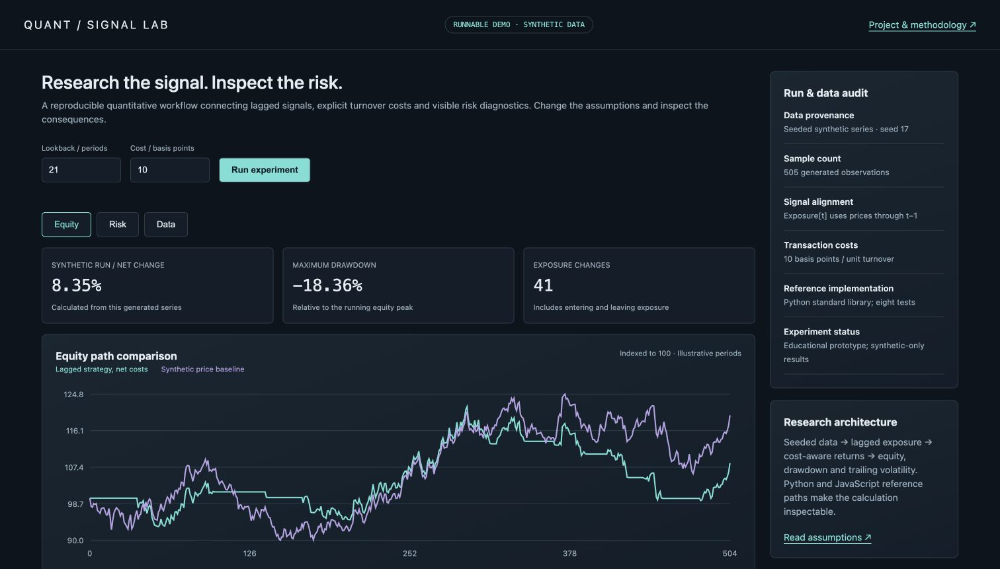
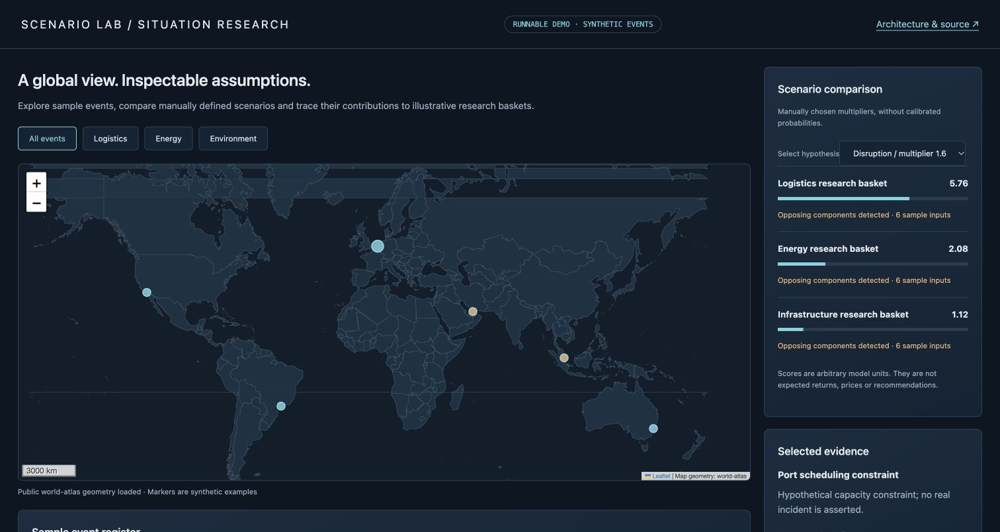
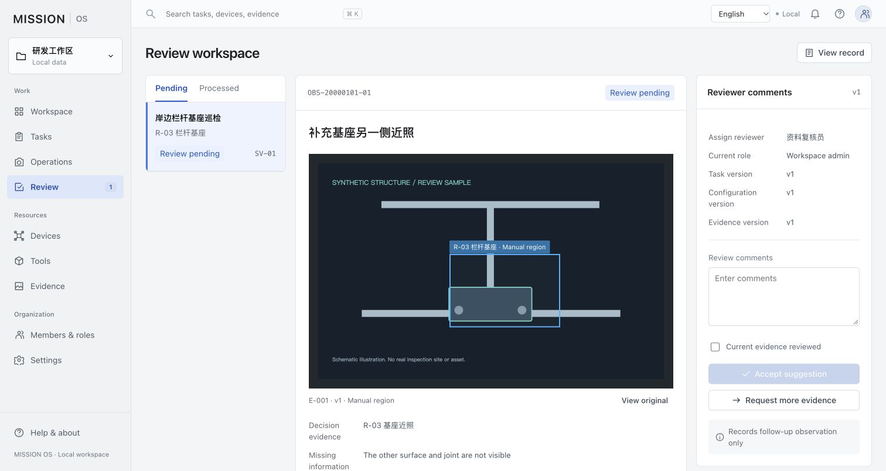

# Systems Research Lab

An anonymous collection of inspectable engineering demonstrations: synthetic quantitative research, event/scenario exploration, mission review workflows and numerical algorithms.

**Status:** AI-assisted educational prototypes. All event records, actors, device labels, dates and market series are fictional examples. Interface images show either this runnable demonstration or explicitly labelled design exploration. This repository contains no biography, education or employment history, contact information, private archives, live accounts or credentials.

## Run locally

Download this repository, open its folder and run:

```sh
python3 -m http.server 8080 --bind 127.0.0.1
```

Open `http://localhost:8080/`. No account, API key or broker connection is needed. Dependencies and map geometry are included locally; the demonstrations make no third-party data requests.

## Featured project

**SMART3D · Parametric Studio** — a focused parametric modelling and assembly showcase with genuine browser mesh Boolean operations, bill of materials and GLB export.

[Open the studio](https://007jackiegao-cmd.github.io/smart3d-showcase/) · [Inspect source and architecture](https://github.com/007jackiegao-cmd/smart3d-showcase)

The original backend remains private. This new public demonstration uses synthetic components and clearly states its validation scope.

## Included demonstrations

| Component | Runnable interface | Inspectable implementation |
|---|---|---|
| Quantitative research | [Quant Lab](quant.html) | `backtest.py`, `research-ui.js`, [methodology](QUANT_METHODOLOGY.md) |
| Scenario exploration | [Scenario Lab](scenario.html) | `scenario-engine.js`, `scenario-app.js`, [methodology](SCENARIO_METHODOLOGY.md) |
| Mission review workflow | [Mission Lab](mission.html) | `mission-app.js`, `mission-data.js`, `mission-i18n.js` |
| Thermal modelling | Command line | `thermal_model.py`, `example_results.json` |
| Resilient asynchronous cache | Command line | `resilient_cache.py` |

Quant Lab uses seeded generated prices, lagged signals, explicit turnover costs, drawdown and trailing volatility. Scenario Lab compares manually chosen hypotheses on synthetic events; map locations are broad illustrative coordinates. Mission Lab uses fictional roles and records. Roles control frontend actions only and do not provide production authentication. Mission changes are temporary; do not enter personal or confidential information.

The thermal model fits a fan curve, solves a pressure balance and sweeps fin geometry. It is a numerical example, not a measured hardware result. Polynomial extrapolation is flagged in outputs. The cache example uses fake providers and demonstrates concurrent-call sharing, fallback, stale limits and cancellation handling.

## Verify the computation

```sh
python3 -m unittest -v test_algorithms.py test_backtest.py
node test-scenario.js
```

The computations are simplified. They do not establish real-world system performance or investment returns. Further validation is required before empirical use.

## Data and privacy boundaries

Only allowlisted demonstration source and generic assets are included. No original private projects, configuration archives, personal photographs, user directories, browsing history, database exports, financial holdings or employee records are included. Images carry no personal EXIF metadata. Old repositories are not linked or reused as public history.

Platform account handles and standard hosting access logs remain platform metadata; this repository makes no claim of unlinkability to an existing account. See [content and dependency inventory](CONTENT_INVENTORY.md).

No additional reuse license is granted for original demonstration code by this showcase. Bundled third-party libraries retain their upstream licenses.

## Actual interface previews

These images are screenshots of the included runnable demonstrations using synthetic inputs.






