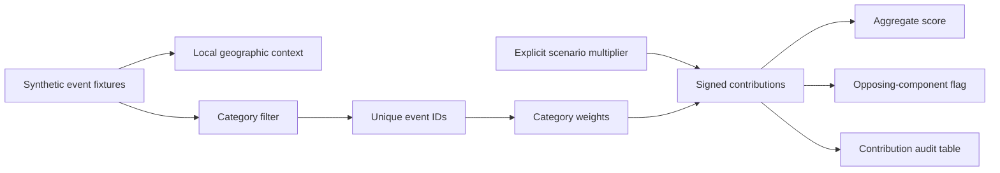

# Scenario Architecture

`scenario-engine.js` defines the scenario multipliers, input checks, ID deduplication and contribution aggregation. `scenario-app.js` contains the six fictional event fixtures, three illustrative baskets, filtering and rendering. Leaflet, topojson-client and world-atlas geometry are served from local files.

The current public implementation is independent of private event ingestion, context/search modules, backend connectors and account-specific lenses. It contains no original private source archive or operational dataset.

The selected-event panel exposes the fixture ID, category, manual shock and explanatory note. The contribution table shows every active signed component; the aggregate score and conflict flag are calculated from those same components.
